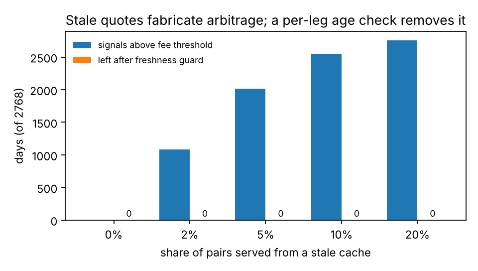
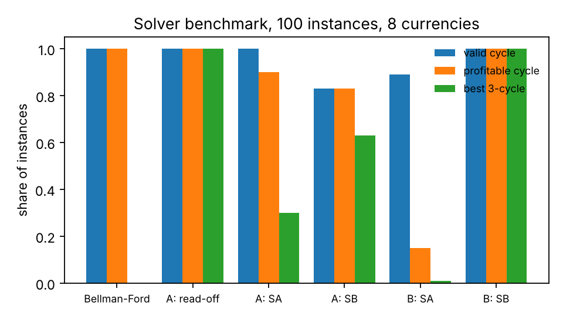

# fx-arbitrage-qubo

Detecting currency-cycle (triangular) arbitrage as a QUBO problem, benchmarked
honestly against classical algorithms on public ECB exchange-rate data.

The question this repository answers is narrow: **when you cast "find the most
profitable currency cycle" as a QUBO for a quantum-inspired solver, what does the
solver actually add, and what can go wrong in the evaluation?** Everything runs on
a laptop in about two minutes, from one public data file.

## Results in one screen

Data: ECB euro reference rates for EUR, USD, JPY, GBP, CHF, AUD, CAD and NZD,
2016-01-04 to 2026-10-23 (2,768 business days). Full numbers are in
[`results/RESULTS.md`](results/RESULTS.md), regenerated by `make reproduce`.

1. **Reference rates contain no arbitrage.** Across all days and all 112
   three-currency cycles, the largest cycle log-sum on mid rates is 1e-15
   (floating-point noise): the ECB quotes everything against the euro, so cross
   rates are consistent by construction. With a 1 bp spread, every cycle loses
   1.5 bp. Any "opportunity" a backtest finds in data like this is a bug.

2. **Stale quotes fabricate arbitrage on most days, and a per-leg age check removes
   all of it.** If a replay engine serves a few pairs from an older cache while the
   other legs are fresh, the legs describe different moments and their product
   drifts by the market move in between.

   | Pairs served stale | Days with a signal above a 6 bp fee threshold | Left after the freshness guard |
   |---|---|---|
   | 0% | 0 | 0 |
   | 2% | 1,087 | 0 |
   | 5% | 2,013 | 0 |
   | 20% | 2,755 | 0 |

   

3. **The obvious QUBO is trivial; the interesting one is hard for annealing and easy
   for simulated bifurcation.** On 100 instances built from real days with an injected
   3 to 10 bp mispricing:

   | Method | Profitable cycle | Best 3-cycle | ms per instance |
   |---|---|---|---|
   | Bellman-Ford (classical, any cycle length) | 100% | n/a | 0.2 |
   | A, cycle selection: read the diagonal | 100% | 100% | 0.0 |
   | A, cycle selection: simulated annealing | 90% | 30% | 344 |
   | A, cycle selection: simulated bifurcation | 83% | 63% | 491 |
   | B, edge selection: simulated annealing | 15% | 1% | 183 |
   | B, edge selection: simulated bifurcation | 100% | 100% | 220 |

   

   - **Formulation A** (one binary variable per enumerated cycle, one-hot penalty)
     is the formulation most naturally written first. Every feasible point is a
     single cycle, so its ground state is simply the smallest diagonal entry: a
     heuristic solver can only match enumeration, never beat it.
   - **Formulation B** (one variable per directed edge, penalties for flow
     conservation, out-degree, 2-cycles and cycle length) is where a solver has to
     search. Single-flip simulated annealing almost never moves between valid
     cycles, because changing a cycle needs several edge flips through infeasible
     states. Ballistic simulated bifurcation, whose continuous dynamics pass
     through those states, finds the optimum on every instance.
   - Neither beats Bellman-Ford or enumeration for 8 currencies; the value of the
     QUBO path would only appear at sizes where enumeration is impossible, and
     that claim needs its own benchmark.

## What is in the code

```
src/fxqubo/
  data.py     ECB download (cached, SHA-256 recorded), mid rates -> bid/ask with an explicit spread assumption
  graph.py    log-weight graph, cycle enumeration (each cycle once), Bellman-Ford, gauge fixing
  qubo.py     formulations A and B, decoders, objective/penalty normalisation
  solvers.py  simulated annealing and ballistic simulated bifurcation (NumPy, no dependencies)
  replay.py   historical replay with an optional per-leg quote-age guard
experiments/run_all.py   reproduces every number and figure in results/
tests/                   unit tests (pytest), run in CI
```

Three implementation details worth a look:

- **Gauge fixing** (`graph.gauge_fix`). Adding a node potential
  `w'[i,j] = w[i,j] + phi[i] - phi[j]` leaves every cycle weight unchanged. Choosing
  `phi` by least squares removes price levels (JPY vs GBP) from the edge weights and
  leaves only spreads and mispricings, which shrinks the QUBO coefficients by four
  to five orders of magnitude before normalisation.
- **Penalty-to-objective ratio.** Cycle weights of order 1e-4 under a penalty of
  order 1 are invisible to a heuristic solver. Objectives are normalised, and the
  penalties were tuned once on separate instances and then frozen (documented in
  `qubo.py`).
- **Cycle enumeration.** Listing permutations counts each directed cycle three
  times (once per rotation); `enumerate_cycles` keeps one canonical rotation, so
  8 currencies give 112 three-cycles, not 336.

## Reproduce

```bash
pip install -e ".[dev]"
make test         # unit tests
make reproduce    # downloads the ECB file once, rewrites results/
```

## Scope and limits

- ECB reference rates are one daily fixing, not tradable quotes. The spread (1 bp)
  and fee threshold (6 bp per three-leg cycle) are stated assumptions, not market
  measurements; change them in `experiments/run_all.py`.
- The solver benchmark uses injected mispricings, because real ones do not exist
  in this data. It measures whether a method recovers a known answer, not whether
  arbitrage exists in live markets.
- `simulated_bifurcation` is an independent textbook implementation of ballistic
  SB (Goto et al., *Science Advances* 7, eabe7953, 2021), not Toshiba's SQBM+
  product.
- This is research code, not trading software or financial advice.

## Background

Written by Mohamed Aouad as a public, independent reimplementation of ideas from an
earlier consulting engagement on quantum-inspired FX arbitrage. No client code,
data, configuration or credentials are included; all results here come from public
ECB data.

Data: European Central Bank, euro foreign exchange reference rates
(https://www.ecb.europa.eu/stats/policy_and_exchange_rates/euro_reference_exchange_rates/html/index.en.html),
reused with attribution under the ECB's terms of use.

## License

MIT
